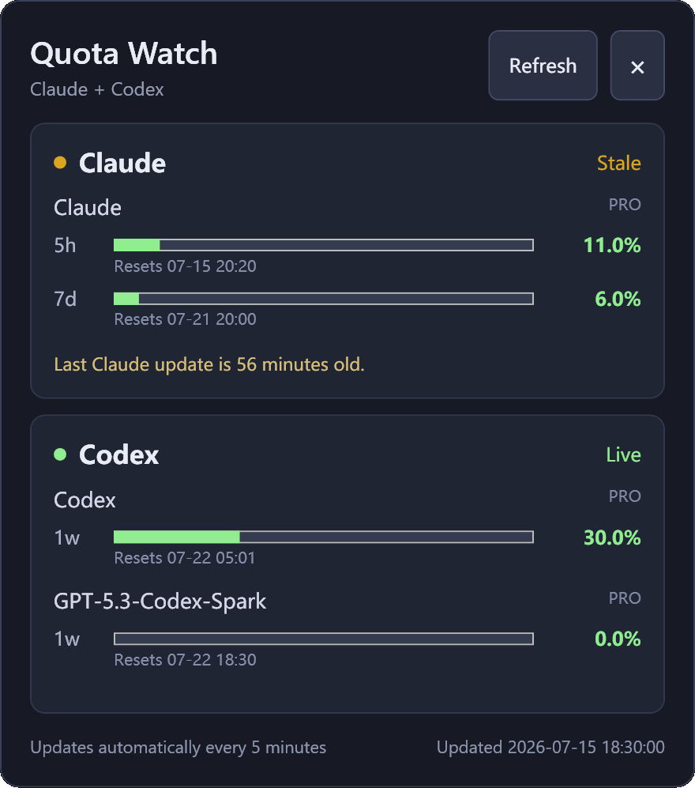

# Quota Watch

[](https://github.com/lazydao/quota-watch/actions/workflows/ci.yml)
[](https://github.com/lazydao/quota-watch/releases/latest)
[](LICENSE)

Windows notification-area and terminal quota monitor for Claude Code and Codex. Quota Watch reads the sessions already authenticated by the official local CLIs and does not store provider credentials.

<p align="center">
  
</p>

## Features

- Windows notification-area app with a click-to-open quota flyout
- Elapsed-time percentages and timeline markers for at-a-glance quota pacing
- One-shot terminal dashboard with `quota`
- Auto-refreshing terminal dashboard with `quota watch`
- Machine-readable output with `quota --json`
- Multi-bucket Codex quota support through `rateLimitsByLimitId`
- Windows-first Claude quota queries every 10 minutes, with local status-line/Desktop history and WSL fallback
- Codex App backend discovery and active, read-only quota queries without a model call
- Claude and Codex subscription-plan labels when their official CLIs expose them
- No browser cookies, OAuth tokens, API keys, or session keys in the cache

## How it is packaged

Quota Watch has two components:

| Component | Installed from | Responsibility |
| --- | --- | --- |
| `quota` CLI | Python package installed with pipx | Reads Claude and Codex quota data and renders terminal or JSON output |
| Windows tray app | Self-contained EXE from GitHub Releases | Displays the flyout and calls the installed `quota --json` command |

The tray EXE is self-contained for .NET, but it still requires the `quota` command. Keeping provider access in the CLI lets the terminal dashboard and tray app share the same adapters, WSL bridge, cache, and authentication.

## Quick start on Windows

The published tray app currently supports Windows x64. You also need Python 3.10 or later and at least one locally authenticated provider: Claude Code and/or Codex.

### 1. Install pipx

Skip this step if `pipx --version` already works.

```powershell
py -m pip install --user pipx
py -m pipx ensurepath
```

Open a new PowerShell window after `ensurepath` updates `PATH`.

### 2. Install the matching CLI version

Set the version to the GitHub Release you intend to use. Installing from a tag keeps the CLI and tray app on the same version instead of following the changing `main` branch.

```powershell
$version = "v0.1.8"
pipx install "git+https://github.com/lazydao/quota-watch.git@$version"
quota --version
```

### 3. Download the tray app

1. Open the [latest GitHub Release](https://github.com/lazydao/quota-watch/releases/latest).
2. Download `quota-watch-tray-<version>-win-x64.zip` and its `.sha256` file.
3. Extract the ZIP to a stable location, for example `%LOCALAPPDATA%\Programs\QuotaWatch\<version>`.
4. Run `QuotaWatch.Tray.exe`.

The icon may initially appear in the notification-area overflow. Move it to the visible area from Windows taskbar settings if desired. If Windows displays an unfamiliar-download warning, compare the ZIP's SHA-256 hash with the published checksum before running it:

```powershell
$archive = ".\quota-watch-tray-$version-win-x64.zip"
(Get-FileHash $archive -Algorithm SHA256).Hash
```

### 4. Connect providers

Codex needs no additional Quota Watch setup. For Claude Code running directly on Windows:

```powershell
quota setup-claude
```

For Claude Code running in the default WSL distribution:

```powershell
quota setup-claude --wsl
```

Then start or continue a Claude Code session and send at least one model request. Confirm that the CLI works before relying on the tray app:

```powershell
quota
quota --json
```

## Terminal-only install

The CLI also works without the Windows tray app. On macOS, Linux, or WSL, install pipx using your Python environment, then install the same tagged package:

```bash
version="v0.1.8"
pipx install "git+https://github.com/lazydao/quota-watch.git@${version}"
quota
```

## Usage

```powershell
quota
quota --json
quota watch --interval 30
```

Watch mode uses the terminal's alternate screen and replaces the completed dashboard in place. Resizing the terminal redraws the current dashboard without querying the providers again. Press `Ctrl+C` to return to the original terminal contents.

### Windows notification-area app

- Left-click the icon to toggle the quota flyout.
- Click elsewhere, press `Esc`, or click the close button to hide the flyout.
- Right-click the icon to refresh, open the terminal dashboard, enable launch at sign-in, or exit.
- The last successful snapshot is shown immediately while a refresh runs in the background.
- Quotas refresh automatically every five minutes.

The tray app calls `quota --json` without opening a console window. Set `QUOTA_WATCH_CLI_PATH` to the full `quota.exe` path if the command is installed but unavailable on the tray process's `PATH`. Restart the tray app after changing environment variables.

Enable **Start with Windows** only after placing the EXE in its final location. The startup entry records the EXE's absolute path, so moving it later requires disabling and re-enabling startup from the new copy.

## Claude Code

Claude Code exposes quota percentages and reset timestamps to local status-line commands. Configure the bridge once:

```powershell
quota setup-claude
```

Quota Watch stores only the filtered quota snapshot under the user's local cache directory. On Windows, each 10-minute collection attempt first queries the usage endpoint using the existing Windows Claude Code login. It reads `%USERPROFILE%\.claude\.credentials.json`, or the directory selected by `CLAUDE_CONFIG_DIR`. An explicitly supplied `CLAUDE_CODE_OAUTH_TOKEN` takes priority, but must have permission to query quotas: the long-lived token from `claude setup-token` is not guaranteed to have that permission.

Environment variables must be visible to the Windows `quota` process. A token exported only in a WSL shell is not imported into Windows. Restart the tray app after changing its environment.

The request is a read-only HTTPS GET to `api.anthropic.com`; it sends no prompt and consumes no model tokens. Quota Watch does not install Claude Code, launch login, or write/refresh credentials. Known-expired file credentials fail locally; renew them using Claude Code itself. Merely leaving Claude Desktop open does not renew the separate Claude Code login.

If the Windows query cannot run, fresh local quota data is preferred over WSL: first the filtered CLI/status-line cache, then Windows Claude Desktop history. WSL is queried only when neither has fresh usable data. Its helper keeps the WSL access token inside WSL and returns filtered quota fields only. Set `QUOTA_WATCH_CLAUDE_WSL_DISTRO` when that fallback login is in a non-default distribution. Failed queries preserve usable local data with its original capture time.

The OAuth usage endpoint is not a documented public Anthropic API, so the status-line bridge remains the failure-safe fallback. See [Claude active refresh](docs/claude-active-refresh.md) for the exact security and compatibility boundary.

Claude Code may omit `rate_limits` before the first model response. During that normal startup window, the bridge waits quietly or displays the last cached quota instead of reporting an error.

If Claude Code already has a custom `statusLine`, `quota setup-claude` leaves it untouched and prints the command that needs to be chained into the existing setup.

Use `quota setup-claude --dry-run` to inspect the change without writing it.

### Claude Desktop fallback on Windows

If the Windows query fails and the CLI cache is unavailable or stale, Quota Watch
can read Claude Desktop's local `plan-usage-history.json`. The regular Windows
app and current Microsoft Store package are detected automatically. Relocated
Store data under `%LOCALAPPDATA%\Claude-Data\claude_pzs8sxrjxfjjc`
is also detected, even when the legacy Store history no longer exists. Recent,
complete CLI data remains preferred; otherwise, the newer usable local snapshot
is selected without overwriting the CLI cache. Fresh Windows history prevents
an unnecessary WSL query; stale history remains a last-resort fallback.

The desktop fallback provides only all-model 5-hour and 7-day percentages. Its
original capture time is preserved, and data older than 15 minutes is marked
`Stale`. Reset times, model-specific quotas (such as Fable), and subscription
tiers are not present in this history, so `Time —` is shown and missing fields
are not copied from another source. A message identifies the partial fallback.

This reads a local history file only: no cookies or credentials are accessed,
no network request or model call is made, and no app settings are changed.
Claude Desktop may pause background updates while idle; simply keeping it open
does not guarantee fresh data. Missing or incompatible history files are ignored.

### Claude Code in WSL

When the dashboard runs on Windows but Claude Code runs in WSL, connect the default distribution with:

```powershell
quota setup-claude --wsl
```

Select a non-default distribution with `--distro`, and preview all changes with `--dry-run`:

```powershell
quota setup-claude --wsl --distro Debian --dry-run
```

The setup creates a small wrapper under the WSL user's `~/.claude` directory. If a custom status line already exists, its output is preserved and the original settings file is backed up before the wrapper is enabled. WSL forwards only the status-line JSON to the Windows `quota.exe`, so both environments share the same filtered quota cache.

Quota data can come from a selected non-default distribution, but the Claude subscription label currently falls back to the local Windows installation or the default WSL distribution.

## Codex

No additional setup is needed. Quota Watch locates the official local Codex executable, launches `codex app-server`, and calls `account/rateLimits/read` over JSONL stdio. The adapter displays every quota bucket returned by the installed Codex version.

Executable discovery prefers the newest versioned Windows Codex App backend, then its legacy bundled executable, the official standalone Windows install, and finally `codex` on `PATH` (including npm installs). This queries the official local backend rather than scraping the app's UI or reading its tokens. The backend uses the existing login and credential-store configuration; `CODEX_HOME`, when set, is respected. No thread or model turn is started.

Set `QUOTA_WATCH_CODEX_PATH` when Codex is installed in a non-standard location. Restart the tray app after changing it.

## Troubleshooting

Start with `quota --json`. If that command fails or returns unavailable providers, the tray app will show the same underlying result.

### The tray app cannot find `quota`

```powershell
Get-Command quota
pipx list
```

Open a new terminal after installing pipx. If `quota` works in PowerShell but the tray still cannot find it, set `QUOTA_WATCH_CLI_PATH` to the full path returned by `(Get-Command quota).Source`, then restart the tray app.

### Claude is unavailable or stale

- Confirm that Windows Claude Code is logged in with a Claude.ai subscription. If its access token has expired, let Claude Code renew it or sign in again there; Quota Watch never rotates the credentials itself.
- Check `CLAUDE_CONFIG_DIR` and `CLAUDE_CODE_OAUTH_TOKEN` if you use them. A token that works for conversations may still lack quota-query permission; HTTP 401/403 safely fall back to other data sources.
- WSL is a fallback, not the first source. If needed, confirm its Claude Code login or set `QUOTA_WATCH_CLAUDE_WSL_DISTRO`.
- Run `quota setup-claude` or `quota setup-claude --wsl` to keep the status-line fallback available.
- Start or continue Claude Code and send at least one model request; startup status-line input may not contain `rate_limits` yet.
- `Stale` means the selected Claude snapshot has not been refreshed recently. It is not an authentication failure by itself.
- A `Claude Desktop fallback` message means only local all-model percentages are available; missing time, model and plan details are expected.
- Preview a WSL setup without changing files with `quota setup-claude --wsl --dry-run`.

### Codex is unavailable

Confirm that the official CLI works:

```powershell
codex --version
```

If Codex is outside the usual install locations, set `QUOTA_WATCH_CODEX_PATH` to the executable's full path.

### The tray icon is missing

Check the Windows notification-area overflow first. Quota Watch intentionally does not create a normal taskbar button. Running another copy is unnecessary; use the existing icon to show or hide the flyout.

## Upgrade

1. Download and verify the new tray ZIP from [GitHub Releases](https://github.com/lazydao/quota-watch/releases).
2. Disable **Start with Windows** from the old tray copy if the new EXE will use a different directory, then exit the old copy.
3. Install the CLI from the same release tag:

   ```powershell
   $version = "v<new-version>"
   pipx install --force "git+https://github.com/lazydao/quota-watch.git@$version"
   ```

4. Extract and launch the new tray app.
5. Re-enable **Start with Windows** from the new copy when its path changed.
6. Remove the old version directory after confirming that `quota --version` and the flyout work.

## Uninstall

1. Right-click the tray icon, disable **Start with Windows**, and exit Quota Watch.
2. Remove the CLI:

   ```powershell
   pipx uninstall quota-watch
   ```

3. Delete the extracted tray directory and any shortcut you created.

Quota Watch intentionally leaves provider-owned Claude and Codex authentication untouched.

## Data flow and privacy

```text
Windows Claude Code -- usage GET (10 min) --> local cache ---+
Claude status line -------- fallback snapshot --------------|
Claude Desktop history ---- partial local fallback ---------|
WSL Claude OAuth ---------- last active fallback ------------|
                                                             +--> quota CLI --> terminal / JSON --> tray app
Windows Codex App / CLI --- read-only app-server JSON-RPC ---+
```

Claude data can be marked stale when its available sources have stopped producing fresh snapshots. Cached windows with known reset timestamps are hidden after their reset passes; desktop history does not contain reset timestamps and is identified as a partial fallback. Codex App Server is currently an experimental interface, so Quota Watch keeps that protocol behind an isolated adapter.

See [SECURITY.md](SECURITY.md) for the stored-data boundary and private vulnerability-reporting instructions.
See [Windows-first collection](docs/windows-first-collection.md) for source priority, token-cost boundaries, and verification criteria.

Protocol references: [Claude Code status line](https://code.claude.com/docs/en/statusline), [Codex App Server](https://developers.openai.com/codex/app-server/), and [Codex CLI installation](https://github.com/openai/codex#installing-and-running-codex-cli).

## Development

See [CONTRIBUTING.md](CONTRIBUTING.md) for local setup and verification commands. Maintainers can find the tag-driven release checklist in [docs/releasing.md](docs/releasing.md).

## License

MIT
